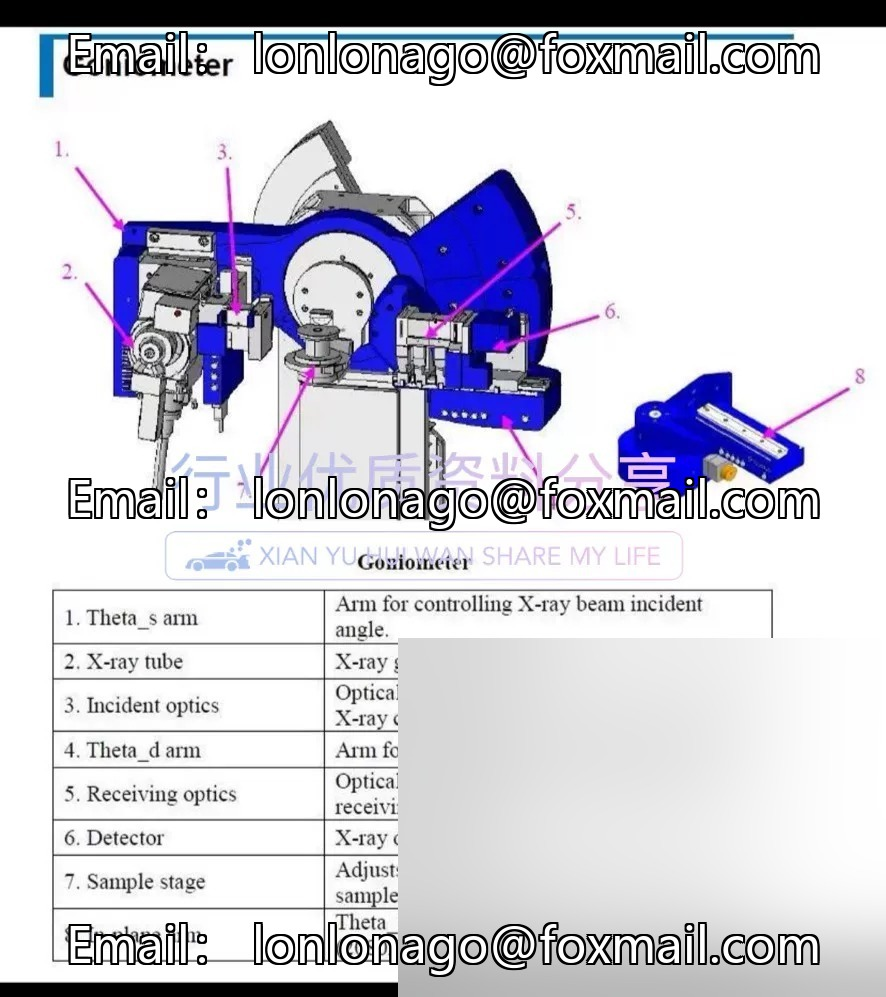
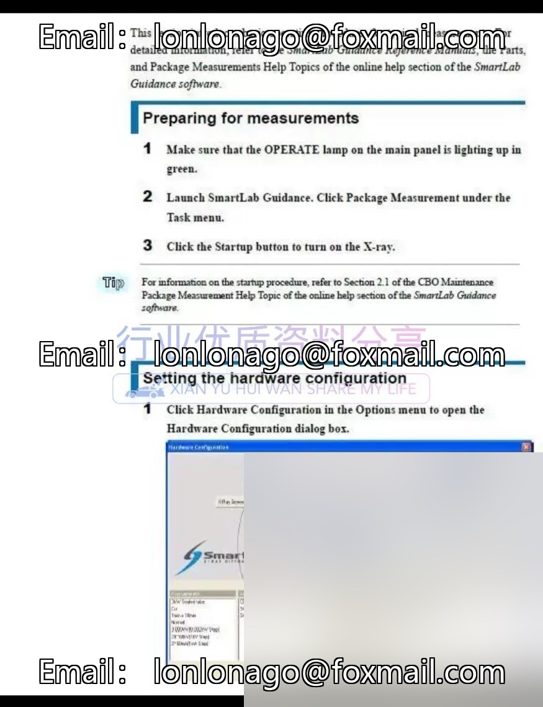
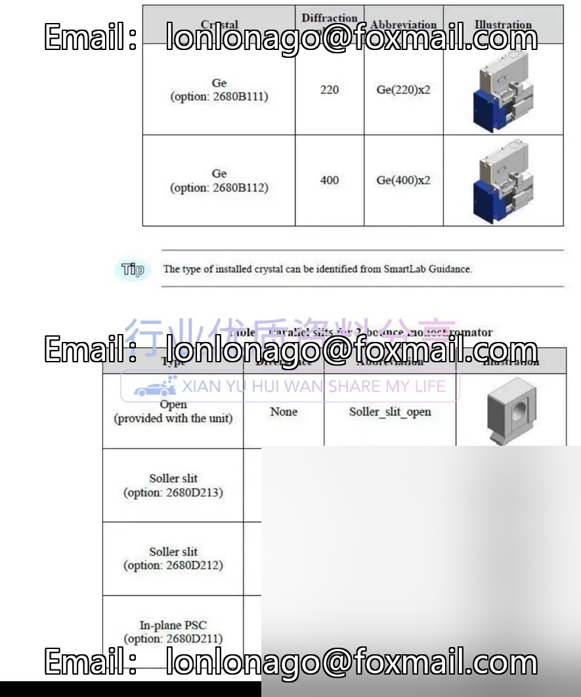
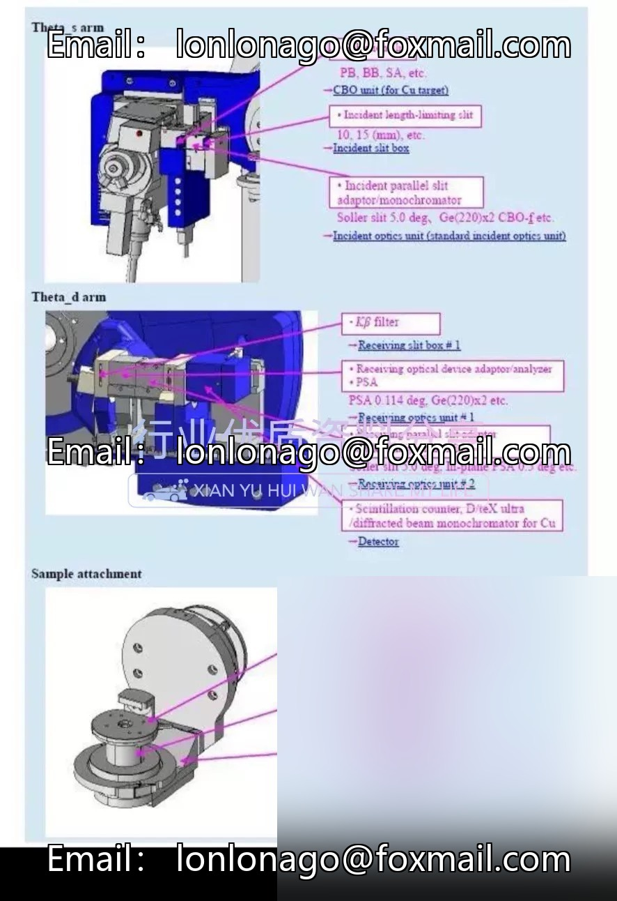
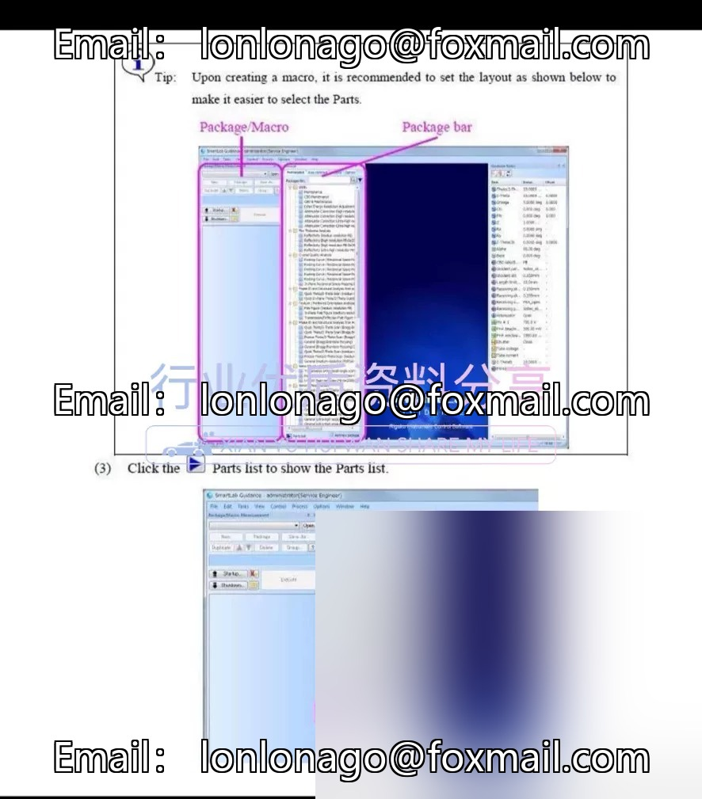
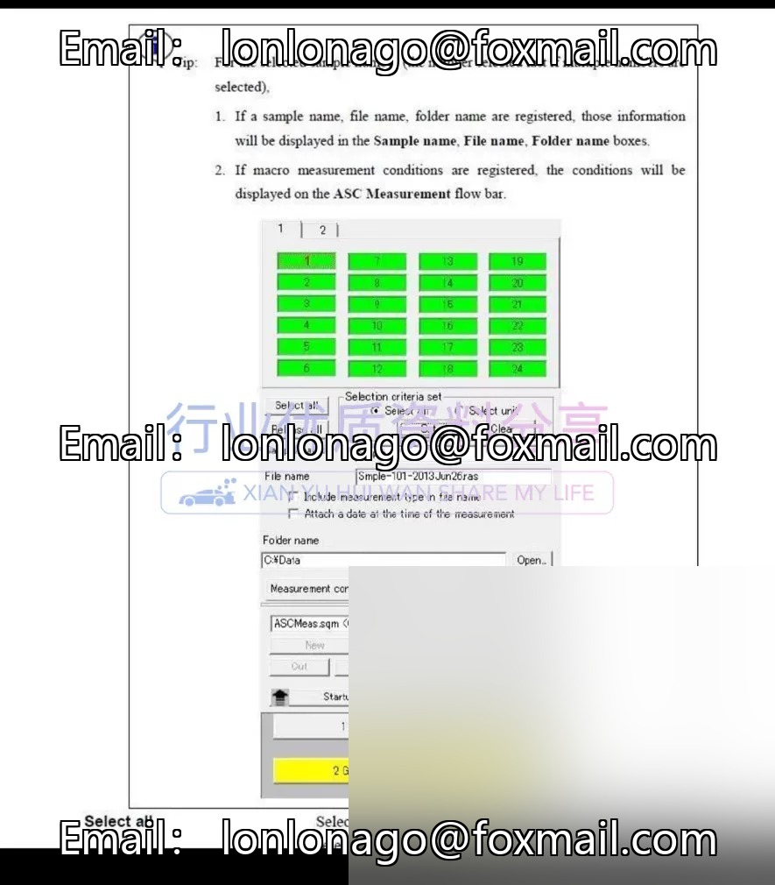

# The Japanese RYIELD SmartLab Multifunctional X-ray Diffraction Instrument XRD Technology Manual

## Body

Japanese Rayscience SmartLab multi-function X-ray diffraction instrument XRD technical manual

The content is comprehensive, including explanations of equipment structure principles, operation and maintenance methods, etc., and has great reference value.

Capture and send the electronic original directly! The following images include screenshots of the file portion. Please confirm before placing the order! Due to the replicable nature of electronic documentation Therefore, are allowed after purchase! Thanks for understanding!

For personal learning and reference use only.

The manual covers equipment structure principles, operation and maintenance methods, along with file screenshots, and is intended for personal learning and reference; it can be copied and is not returnable.

<!-- AI_ENRICHED -->

## Images

## Payment

Here is a pay link on Stripe ( https://buy.stripe.com/3cs8yP7sY87d0vu9AB ). Please contact me lonlonago@foxmail.com after funding $89, and I will send you a complete data files , thank you!

